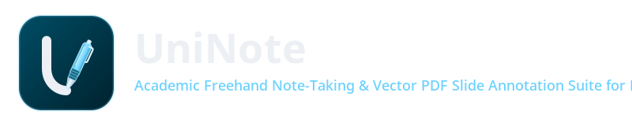
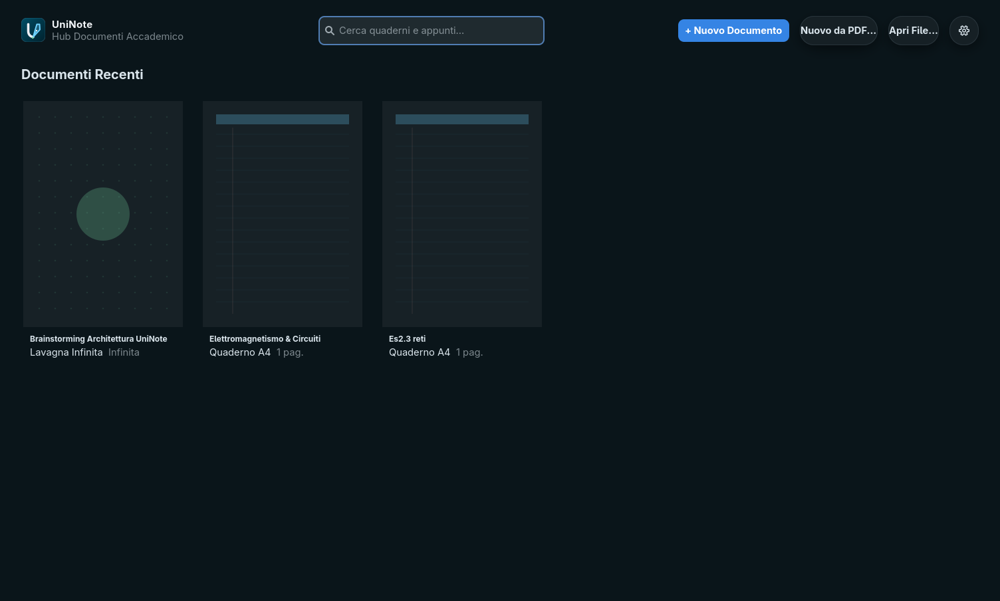
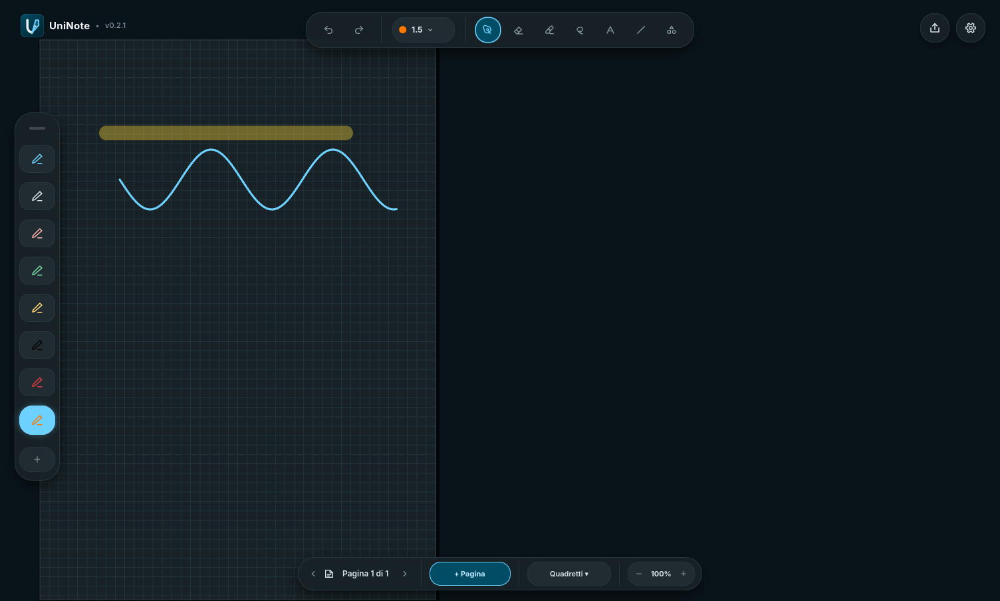
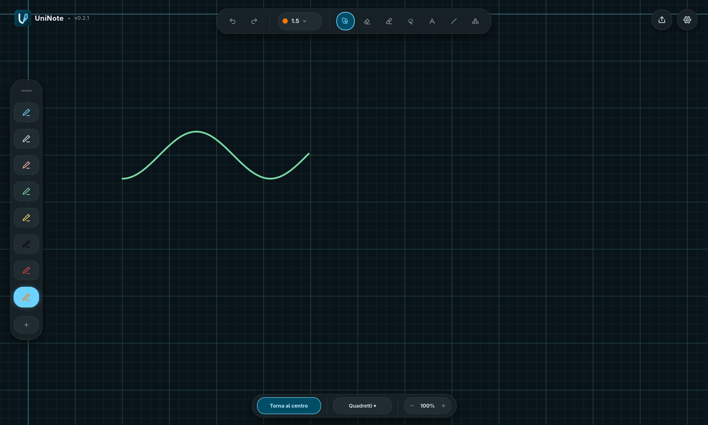

# UniNote

<div align="center">



<br/>

**An Academic Freehand Note-Taking & Vector PDF Slide Annotation Suite for Linux**

[](LICENSE)
[-orange.svg?logo=rust)](https://www.rust-lang.org/)
[](https://gtk.org/)
[](Cargo.toml)
[](packaging/aur/uninote/PKGBUILD)
[](packaging/flatpak/org.uninote.UniNote.yaml)
[](https://github.com/Loreexe/UniNote/actions/workflows/ci.yml)
[]()
[]()

[Screenshots](#-screenshots--interface-showcase) •
[Packaging & Install](#-packaging--quick-install) •
[Features](#-key-features) •
[Architecture](#-system-architecture) •
[Shortcuts](#-keyboard-shortcuts--gestures) •
[License](#-license)

</div>

---

## 📖 Abstract & Overview

**UniNote** is a native, high-performance Linux desktop application engineered specifically for university STEM lectures, mathematical derivations, academic research, and engineering design. Built from the ground up in **Rust (2021 Edition)**, **GTK 4 (v4.10+)**, **Libadwaita (0.7)**, and **Cairo**, UniNote bridges the divide between modern high-frequency digitizer hardware (Microsoft Pen Protocol 2.0/2.5, ELAN digitizers on 2-in-1 laptops, Wacom EMR/AES tablets) and the modern Linux Wayland desktop (Niri, GNOME, Sway, Hyprland).

Unlike conventional note-taking suites that rely on heavy Electron/Chromium runtimes or lossy raster bitmap canvases, UniNote maintains an uncompromising **pure vector pipeline**:
- **120Hz Sub-Millisecond Inking Engine**: Predictive centripetal Catmull-Rom splines converted analytically to piecewise cubic Bézier curves, paired with an adaptive One Euro ($1€$) filter and dynamic pressure width synthesis.
- **Hardware-Calibrated Digitizer Protection**: Strict physical impact latching (`pending_down`), instantaneous anti-hover cutoff upon stylus liftoff, capacitive blip rejection ($<0.065$ pressure peak), and a 4-state palm rejection machine with automatic proximity decay.
- **Infinite Whiteboard & Discrete Metric A4 Notebooks**: Unbounded Cartesian $(-\infty, +\infty)$ ideation with dynamic procedural zoom-adaptive grid alongside calibrated A4 notebooks (Warm Natural White, 8mm Ruled with margin, 5mm Metric Grid).
- **University PDF Document Flow**: Native non-destructive slide and handout annotation via `poppler-glib` with a dual-tier 120Hz Cairo cache (< 200 µs blit time) and typographic multi-page vector export via `cairo::PdfSurface`.
- **Spatial Selection & Geometric Synthesis**: Freehand polygonal lasso and rectangular marquee with Ray-Casting containment, real-time 120Hz interactive drag translation, and atomic undo/redo commands.
- **Crash-Resilient Storage**: Embedded SQLite 3 in Write-Ahead Logging (`WAL`) mode with asynchronous background thread persistence and single-file consolidated backup export via the SQLite Online Backup API.
- **Dank Material Shell (DMS) / Material You (M3) Interface**: Full-bleed floating island UI with adaptive dark/light theme switching, Matugen vibrant color token synchronization, and pure vector Cairo iconography.

---

## 📸 Screenshots & Interface Showcase

<div align="center">

### 1. Hub Accademico & Dashboard Documenti
*Visualizzazione a schede con miniature Cairo vettoriali, ricerca istantanea e azioni rapide di creazione.*
<br/>


<br/><br/>

### 2. Quaderno A4 Standard
*Inchiostrazione fluida a 120Hz con spline Catmull-Rom, evidenziatore uniforme a passata singola e isola strumenti Dank Material Shell.*
<br/>


<br/><br/>

### 3. Lavagna Infinita
*Spazio cartesiano continuo $(-\infty, +\infty)$, griglia procedurale dinamica e pulsante di ricentratura rapida all'origine.*
<br/>


</div>

---

## 🏗️ System Architecture

UniNote is organized as a Cargo virtual workspace consisting of **four decoupled crates** with clean interface boundaries:

```
UniNote/
├── Cargo.toml                      # Workspace manifest (Rust 2021, GPL-3.0, Version 0.2.1)
├── LICENSE                         # Verbatim GNU General Public License v3.0
├── design/                         # Dank Material Shell (DMS) UI/UX prototyping (FigCraft)
│   ├── uninote.figcraft            # Native vector UI design document
│   └── previews/                   # 2x HiDPI preview renders
└── crates/
    ├── uninote-core/               # Mathematical document model & coordinate spaces
    ├── uninote-stroke/             # Inking physics, filtering, palm rejection & selection
    ├── uninote-storage/            # SQLite WAL persistence & asynchronous worker
    └── uninote-app/                # GTK4/Libadwaita shell, Cairo canvas, PDF & DMS UI
```

### Data Flow & Component Topology

```
+-------------------------------------------------------------------------------+
|                             UniNote Application                               |
|                               (uninote-app)                                   |
|  - GtkApplication / Libadwaita (DMS Floating Islands & Matugen Tokens)        |
|  - 120Hz Continuous Cairo Canvas & Procedural Zoom-Adaptive Whiteboard Grid   |
|  - Academic Dashboard (GtkFlowBox Grid, Cairo Thumbnails 240x340 px)          |
|  - Multi-Tab Settings Window (AdwPreferencesWindow: Hardware, DMS, Shapes)    |
|  - Poppler PDF Engine (Dual-Tier Cache, Sharpness at Rest, Vector PDF Export) |
+---------------------------------------+---------------------------------------+
                                        |
                +-----------------------+-----------------------+
                |                                               |
                v                                               v
+-------------------------------+               +-------------------------------+
|         uninote-core          |               |        uninote-stroke         |
|  - DocumentFormat Model       |               |  - Centripetal Catmull-Rom    |
|    (Notebook A4 / Whiteboard) |               |  - One Euro Filter (1€)       |
|  - Continuous Viewport & Pan  |               |  - Palm Rejection Machine     |
|  - Affine Coordinate Spaces   |               |  - MPP Anti-Hover & Anti-Blip |
|  - Monotonic Atomic Commands  |               |  - Perfect Shape Synthesis    |
|    (DocCommand::MoveItems)    |               |  - SelectionEngine (Ray-Cast) |
+---------------+---------------+               +---------------+---------------+
                |                                               |
                +-----------------------+-----------------------+
                                        |
                                        v
+-------------------------------------------------------------------------------+
|                                uninote-storage                                |
|  - SQLite 3 Engine (WAL Mode, synchronous = NORMAL, busy_timeout = 5000)      |
|  - Schema V2 (Background Extra, Metadata Format, Document Format Migration)   |
|  - Dedicated Background Thread Worker (Non-blocking Graphics Pipeline)        |
|  - SQLite Online Backup API for Atomic Consolidated .uninote Exports          |
+-------------------------------------------------------------------------------+
```

---

## ✨ Key Features

### 1. 120Hz Sub-Millisecond Inking Engine
- **Centripetal Catmull-Rom Cubic Bézier Interpolation**: Input samples $(x, y, p, t)$ are transformed into $C^1$-continuous piecewise cubic Bézier curves analytically without cusps, self-intersections, or knot overshoot.
- **Adaptive One Euro ($1€$) Filter**: Decoupled positional and pressure smoothing using dynamically modulated cutoff frequencies, suppressing hand tremor while eliminating perceptual latency during fast ballistic strokes.
- **Hardware-Calibrated Microsoft Pen Protocol (MPP 2.0/2.5) Handling**:
  - *Glass Impact Latching (`pending_down`)*: Anchors the first physical point of contact on glass before high-frequency streaming starts.
  - *Anti-Hover Liftoff Cutoff*: Drops air samples immediately upon pressure falling below threshold, preventing diagonal trailing spikes on detached letters (`E`, `T`, `F`).
  - *Anti-Blip Capacitive Filter*: Discards spurious capacitive touch noise with pressure peaks below $0.065$.
- **Robust Palm Rejection State Machine**: 4-state engine (`Idle`, `PenProximity`, `PenDrawing`, `PenCooldown`) with automatic proximity decay (300ms timeout) and active/suppressed touch slot isolation.
- **Live Diagnostic Telemetry HUD (`F12`)**: Real-time display of digitizer sampling rate (Hz), compositor framerate (FPS), Cairo vector draw latency ($\mu\text{s}$), instantaneous pressure, and rejected sample count.

### 2. Spatial Selection & Geometric Manipulation
- **Dual Selection Modalities**: Freehand closed-loop **Lasso** and diagonal **Rectangular Marquee** (`ActiveTool::Select`).
- **Ray-Casting Algorithm**: Jordan curve theorem (Even-Odd parity) testing stroke point clouds: a stroke is captured if $\ge 80\%$ of its points fall inside the polygon or if its bounding box is fully enclosed.
- **Live Cyan Dashed Bounding Box (`#6DD2FF`)**: Renders with sub-pixel sharpness and includes a central centroid grab handle for drag translation.
- **Interactive Drag Translation at 120Hz**: Selected strokes translate smoothly in real time without floating-point precision drift.
- **Atomic Undo/Redo Integration**: Drag translation commits an atomic `DocCommand::MoveItems` with invertible forward and reverse displacement vectors $(\Delta x, \Delta y)$, fully undoable via `Ctrl+Z`.
- **Rapid Batch Deletion**: Instant deletion of all selected items via the `Delete` or `Backspace` key.

### 3. Infinite Whiteboard & Calibrated A4 Notebooks
- **Discrete Metric A4 Notebooks**:
  - Exact standard A4 dimensions ($595.28 \times 841.89\,\text{pt}$ at 72 DPI) in a vertical continuous scroll layout.
  - Viewport frustum culling: off-screen pages are skipped during Cairo rendering passes.
  - Multilevel ambient dropshadows (`#C2C6D0` 1pt outline) and crisp page dividers.
  - Three geometric vector paper backgrounds:
    - *Natural Warm White*: Clean drafting paper.
    - *University Ruled*: 8mm ($22.68\,\text{pt}$) line pitch with a $35\,\text{pt}$ red margin.
    - *Mathematical Grid*: 5mm ($14.17\,\text{pt}$) metric grid with sub-pixel line calibration.
- **Infinite Whiteboard Format**:
  - Unbounded Cartesian plane $(x, y) \in (-\infty, +\infty)$ without discrete page boundaries.
  - Procedural dynamic zoom-adaptive Cairo grid/dots that scale and fade seamlessly across zoom octaves ($20\% \text{--} 500\%$).
  - One-click *Center Content* command to fit the global bounding box of all drawn strokes to the current window.
  - Dynamic tight bounding-box calculation for vector PDF export of unbounded whiteboard diagrams.

### 4. Academic Dashboard & Settings Hub
- **UniNoteDashboard (`GtkFlowBox`)**:
  - Responsive visual card grid displaying recent documents.
  - Real-time Cairo vector thumbnails ($240 \times 340\,\text{px}$) with local disk caching.
  - Semantic format badges (*Quaderno A4* vs *Lavagna Infinita*).
  - Instant live search bar filtering notebooks by title or modification timestamp.
  - Dedicated `$XDG_DOCUMENTS_DIR/UniNote` default notebook workspace with automatic directory provisioning.
  - Sanitized recent files history (up to 30 items) with automatic pruning of removed files.
- **CreateDocumentDialog**:
  - Modal dialog with rich visual cards for selecting between Notebook A4 and Infinite Whiteboard modes.
- **UniNoteSettingsWindow (`AdwPreferencesWindow`)**:
  - *Hardware Digitizer & Stylus Tab*: Contact threshold slider (default 0.05), live pressure testing bar, sensitivity curve selector (Linear, Soft, Hard), anti-hover toggle, 1€ filter tuning, palm rejection timeouts, and F12 HUD overlay toggle.
  - *Appearance & DMS Tab*: Desktop theme sync, OLED Pure Black (`#0A151A`), Natural Light theme, ITU-R Rec. 709 perceptual ink adaptation toggle, ruling contrast, and floating bar opacity.
  - *Tools & Shapes Tab*: Line orthogonal snap angle (default 8°), Ramer-Douglas-Peucker (RDP) polygon tolerance, rectangle/ellipse 90° snap (12°), and pen dock color presets.
  - *Shortcuts & Stylus Buttons Tab*: Keybinding customization and stylus barrel button mapping (Eraser, Lasso, Color Picker).

### 5. University PDF Document Flow
- **Non-Destructive Slide & Handout Import**:
  - Native integration with GNOME's `poppler-glib` (`poppler = "0.6.0"`).
  - *Create Notebook from PDF*: Ingests slides of any geometry (A4, 16:9 widescreen, US Letter) as non-destructive vector backgrounds.
  - *Append PDF Pages*: Appends lecture slides directly to the end of an existing notebook.
- **Dual-Tier 120Hz Cairo Cache Architecture**:
  - *Tier 1 (RAM Raster Surface)*: 2x HiDPI raster cache with LRU eviction for instantaneous blitting (< 200 µs) during rapid panning and zooming.
  - *Tier 2 (Poppler Vector Handles)*: Retains live vector page handles for lossless scaling.
  - *Sharpness at Rest*: Automatically re-rasterizes at high resolutions (up to 5x native scale) as soon as pan/zoom gestures settle.
- **High-Definition Tipographic Vector PDF Export (`cairo::PdfSurface`)**:
  - Generates multi-page vector PDFs preserving native Poppler backgrounds and student freehand annotations.
  - Freehand strokes are written as pure cubic Bézier vectors (`cr.curve_to`) preserving dynamic pressure widths, colors, and highlighter transparency ($\alpha = 0.38$). Zero rasterization or blurriness at 300+ DPI.

### 6. Dank Material Shell (DMS) & Dynamic Theming
- **Ergonomic Floating Island Layout**:
  - *Floating Inking Island (Top Pill)*: 9 quick-access controls (Undo, Redo, Stroke Width popover with live Cairo preview and 5 presets, Pen, Eraser, Highlighter, Text, Straight Line, Shape Recognition).
  - *Floating Pen Dock (Left Margin)*: Vertical pill with interactive drag handle and 5 customizable ink slots (Electric Cyan `#6DD2FF`, Warm White `#D9E4EB`, Coral `#FFB4AB`, Mint Green `#79D9A5`, Academic Gold `#FFD875`) plus a color picker palette dialog (`+`).
  - *Floating Bottom Navigation Dock*: Page stepper (`‹ Foglio X di Y ›`), `+ Pagina` button, paper background selector, and zoom controls.
- **Matugen M3 Dynamic Color Synchronization**:
  - Automatically matches system-wide Material You / Dank Material Shell themes (`~/.config/gtk-4.0/dank-colors.css`).
  - *Dark Canvas*: Deep slate background (`#0A151A`), dark pages (`#172126`), calibrated soft cyan rulings, and ITU-R Rec. 709 luminance-adapted inks.
  - *Light Canvas*: Natural warm background (`#FAF9F6`), classic notebooks lines, and deep contrast inks.
- **Pure Vector Cairo Iconography (`icons.rs`)**:
  - All icons (pen, eraser, highlighter, shapes, lasso, settings gear, brand squircle logo) are rendered directly via Cairo vector instructions, eliminating external SVG files, librsvg runtime overhead, and scaling artifacts.

---

## 📦 Packaging & Quick Install

### 1. Arch Linux / CachyOS

Installa direttamente il pacchetto binario `.pkg.tar.zst` precompilato scaricato dalle [Releases](https://github.com/Loreexe/UniNote/releases):
```bash
sudo pacman -U uninote-0.3.0-1-x86_64.pkg.tar.zst
```

Oppure compila e installa in locale dal repository tramite `makepkg`:
```bash
# Versione stabile (v0.3.0):
cd packaging/aur/uninote && makepkg -si

# Oppure versione di sviluppo (branch main):
cd packaging/aur/uninote-git && makepkg -si
```

### 2. Universal Flatpak (.flatpak bundle)

Scarica il bundle standalone `org.uninote.UniNote.flatpak` dalle [Releases](https://github.com/Loreexe/UniNote/releases) e installalo su qualsiasi distribuzione Linux:
```bash
flatpak install --user org.uninote.UniNote.flatpak
```
Ed eseguilo con:
```bash
flatpak run org.uninote.UniNote
```

### 3. Installazione Locale di Sistema da Sorgenti

Se hai clonato il repository, puoi installarlo direttamente in `/usr/local`:
```bash
make icons
make install
```

---

## 💻 Manual Build & Prerequisites

### 1. System Dependencies

UniNote requires standard GTK4, Libadwaita, Cairo, Poppler-GLib, and SQLite development libraries:

#### Ubuntu 24.04 LTS / Debian 12 (Bookworm)
```bash
sudo apt update && sudo apt install -y \
    build-essential \
    pkg-config \
    libgtk-4-dev \
    libadwaita-1-dev \
    libcairo2-dev \
    libpoppler-glib-dev \
    libsqlite3-dev
```

#### Fedora 40 / 41 / RHEL 9
```bash
sudo dnf install -y \
    gcc gcc-c++ \
    pkgconf-pkg-config \
    gtk4-devel \
    libadwaita-devel \
    cairo-devel \
    poppler-glib-devel \
    sqlite-devel
```

#### Arch Linux / CachyOS / Manjaro
```bash
sudo pacman -S --needed \
    base-devel \
    pkgconf \
    gtk4 \
    libadwaita \
    cairo \
    poppler-glib \
    sqlite
```

### 2. Rust Toolchain

UniNote requires **Rust 1.80.0+** (2021 Edition). Install via [rustup](https://rustup.rs/):

```bash
curl --proto '=https' --tlsv1.2 -sSf https://sh.rustup.rs | sh
rustup default stable
```

---

## 🚀 Build & Execution

UniNote uses Cargo workspace commands executed from the project root:

### Run in Optimized Release Mode (Recommended for Inking)
```bash
cargo run -p uninote-app --release
```

### Launch Directly with a File or PDF
```bash
# Open an existing UniNote notebook:
cargo run -p uninote-app --release -- /path/to/notes.uninote

# Import and annotate a lecture PDF:
cargo run -p uninote-app --release -- /path/to/lecture_slides.pdf
```

### Compile the Entire Workspace
```bash
cargo build --workspace --release
```

### Run the Full Automated Test Suite
UniNote includes **475 automated unit, adversarial, stress, and end-to-end integration tests**:
```bash
cargo test --workspace
```

### Code Formatting & Static Analysis
```bash
# Check code formatting:
cargo fmt --all --check

# Strict Clippy linter with zero-warning tolerance:
cargo clippy --workspace --all-targets -- -D warnings
```

---

## ⌨️ Keyboard Shortcuts & Gestures

| Category | Shortcut / Gesture | Action |
| :--- | :--- | :--- |
| **Document Lifecycle** | `Ctrl + N` | Open new document modal (Notebook / Whiteboard) |
| | `Ctrl + O` | Open file dialog (`.uninote` or `.pdf`) |
| | `Ctrl + S` | Save current notebook to disk |
| | `Ctrl + H` | Return to Academic Dashboard |
| **History & Editing** | `Ctrl + Z` | Undo last stroke, shape, or selection translation |
| | `Ctrl + Y` / `Ctrl + Shift + Z` | Redo last undone action |
| | `Delete` / `Backspace` | Batch delete all currently selected items |
| **Viewport & Navigation** | `Pinch-to-Zoom` | Smooth two-finger continuous zoom ($20\% \text{--} 500\%$) |
| | `Two-Finger Drag` | Fluid two-finger pan across continuous canvas |
| | `Ctrl + 0` | Reset viewport zoom to $100\%$ |
| | `Trackpad Two-Finger Scroll` | Smooth vertical & horizontal canvas panning |
| **Tools & Stylus** | `Stylus Barrel Button 1` | Instant eraser toggle or selection tool |
| | `Stylus Eraser Tip` | Hardware eraser automatic detection |
| | `Left Dock Handle Drag` | Fluidly reposition pen dock along the left edge |
| **Diagnostics & Telemetry** | `F12` | Toggle diagnostic HUD overlay (Hz, FPS, $\mu\text{s}$, pressure) |

---

## 📐 Mathematical & Algorithmic Foundations

UniNote applies rigorous computational geometry throughout its pipeline:

### 1. Centripetal Catmull-Rom Spline Formulation
Given four consecutive sampled points $P_0, P_1, P_2, P_3$ with timestamps $t_i$, knot intervals are computed centripetally with parameter $\alpha = 0.5$:
$$t_{i+1} = t_i + \|P_{i+1} - P_i\|^\alpha$$
Centripetal parameterization ($\alpha = 0.5$) guarantees that the interpolated curve possesses no cusps, self-intersections, or overshoot. The spline segment between $P_1$ and $P_2$ is converted into a standard cubic Bézier curve with control points:
$$B_0 = P_1$$
$$B_1 = P_1 + \frac{t_2 - t_1}{3(t_2 - t_0)}(P_2 - P_0)$$
$$B_2 = P_2 - \frac{t_2 - t_1}{3(t_3 - t_1)}(P_3 - P_1)$$
$$B_3 = P_2$$
These cubic Bézier curves are evaluated directly by Cairo's vector rasterizer via `cr.curve_to(B1.x, B1.y, B2.x, B2.y, B3.x, B3.y)`.

### 2. Adaptive One Euro ($1€$) Filter
To filter high-frequency jitter without introducing perceptible phase lag during rapid pen motions, the filter dynamically modulates its cutoff frequency $f_c$ based on the Euclidean velocity magnitude $\dot{x}$:
$$f_c = f_{c,\min} + \beta \|\dot{x}\|$$
where $f_{c,\min} = 1.0\,\text{Hz}$ filters resting tremor, and $\beta = 0.007$ expands filter bandwidth proportionally to stroke speed.

### 3. Ray-Casting Algorithm for Freehand Selection
Given a polygonal lasso loop $V = \{v_0, v_1, \dots, v_n\}$ and a query point $Q$, the containment test calculates the intersection parity of a horizontal semi-infinite ray $R = \{Q + (t, 0) \mid t \ge 0\}$ against all edges $(v_i, v_{i+1})$:
$$\text{Inside}(Q, V) \iff \left( \sum_{i=0}^{n-1} \mathbf{1}_{\{ \text{edge } (v_i, v_{i+1}) \text{ intersects } R \}} \right) \equiv 1 \pmod 2$$
A stroke $S$ consisting of samples $\{s_1, s_2, \dots, s_m\}$ is selected if:
$$\frac{1}{m} \sum_{k=1}^m \mathbf{1}_{\{\text{Inside}(s_k, V)\}} \ge 0.80$$

### 4. Perceptive Ink Color Adaptation (ITU-R Rec. 709)
To guarantee legibility when rendering documents in dark mode without altering the underlying canonical stroke colors stored on disk, UniNote calculates perceptive luminance:
$$Y = 0.2126\,R + 0.7152\,G + 0.0722\,B$$
Inks with low luminance ($Y < 0.28$) and low chroma are non-destructively projected to high-contrast ice white (`#ECEFF4`), while saturated dark chromatic inks are mapped to bright pastel equivalents.

---

## 📄 License

UniNote is free and open-source software licensed under the **GNU General Public License v3.0** ([GPL-3.0](LICENSE)).

```
UniNote — Academic Freehand Note-Taking & Vector PDF Annotation Suite
Copyright (C) 2024-2026 UniNote Developers

This program is free software: you can redistribute it and/or modify
it under the terms of the GNU General Public License as published by
the Free Software Foundation, either version 3 of the License, or
(at your option) any later version.

This program is distributed in the hope that it will be useful,
but WITHOUT ANY WARRANTY; without even the implied warranty of
MERCHANTABILITY or FITNESS FOR A PARTICULAR PURPOSE. See the
GNU General Public License for more details.
```

---

## 🎓 Academic Citation

If you use UniNote in your university coursework, academic research, or software publications, please consider citing:

```bibtex
@software{uninote2026,
  author       = {{UniNote Developers}},
  title        = {{UniNote: An Academic Freehand Note-Taking and Vector PDF Annotation Suite for Linux}},
  version      = {0.3.0},
  year         = {2026},
  url          = {https://github.com/Loreexe/UniNote},
  license      = {GPL-3.0}
}
```
