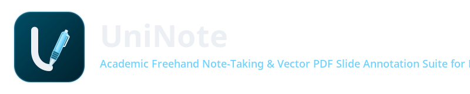

# UniNote

<div align="center">



**An Academic Freehand Note-Taking & Vector PDF Slide Annotation Suite for Linux**

-orange.svg?logo=rust)

[Screenshots](#-screenshots--interface-showcase) •
[Packaging & Install](#-packaging--quick-install) •
[Features](#-key-features) •
[Architecture](#-system-architecture) •
[Shortcuts](#-keyboard-shortcuts--gestures) •
[License](#-license)

</div>

---

## 📖 Abstract & Overview

**UniNote** is a native, high-performance Linux desktop application engineered specifically for university STEM lectures, mathematical derivations, academic research, and engineering design. Built from the ground up in **Rust (2021 Edition)**, **GTK 4 (v4.10+)**, **Libadwaita (0.7)**, and **Cairo**, UniNote bridges the divide between modern high-frequency digitizer hardware (Microsoft Pen Protocol 2.0/2.5, ELAN digitizers on 2-in-1 laptops, Wacom EMR/AES tablets) and the modern Linux Wayland desktop (Niri, GNOME, Sway, Hyprland).

Unlike conventional note-taking suites that rely on heavy Electron/Chromium runtimes or lossy raster bitmap canvases, UniNote maintains an uncompromising **pure vector stroke pipeline** (raster storage is used only for explicitly pasted screenshots):

- **120Hz Sub-Millisecond Inking Engine**: Centripetal Catmull-Rom splines converted analytically to piecewise cubic Bézier curves, paired with an adaptive One Euro ($1€$) filter, zero-allocation Bézier caching, and dynamic pressure width synthesis.
- **Hardware-Calibrated Digitizer Protection**: Strict physical impact latching (`pending_down`), instantaneous anti-hover cutoff upon stylus liftoff, capacitive blip rejection ($<0.065$ pressure peak), and a 4-state palm rejection machine with automatic proximity decay.
- **Infinite Whiteboard & Discrete Metric A4 Notebooks**: Unbounded Cartesian $(-\infty, +\infty)$ ideation with dynamic procedural zoom-adaptive grid alongside calibrated A4 notebooks (Warm Natural White, 8mm Ruled with margin, 5mm Metric Grid), continuous zoom from $25\%$ to $1000\%$.
- **University PDF Document Flow**: Native non-destructive slide and handout annotation via `poppler-glib` with a dual-tier 120Hz Cairo cache (< 200 µs blit time) and typographic multi-page vector export via `cairo::PdfSurface`.
- **Spatial Selection, Images & Geometric Manipulation**: Freehand lasso and rectangular marquee accelerated by a 2D R*-Tree, 8 interactive resize handles, affine scale/rotate, copy/cut/paste, and pasted PNG screenshots stored as hash-addressed `ItemKind::Image`.
- **Eraser, Laser Pointer & Atomic Editing**: Analytical Bézier–circle stroke slicing with per-gesture undo batching, plus a volatile laser pointer whose plasma trail dissolves in 1.2 s without touching Undo/Redo, SQLite, or PDF export.
- **Crash-Resilient Storage**: Embedded SQLite 3 in Write-Ahead Logging (`WAL`) mode with Schema V3 (`assets` hash-addressed table), asynchronous background thread persistence, prepared statements, and single-file consolidated backup export via the SQLite Online Backup API.
- **Dashboard, Local Cloud Folders & Desktop Actions**: Folder sidebar with real filesystem subfolders, drag & drop between folders, Cairo thumbnails, instant search, local Nextcloud/Google Drive folders without credentials, and `--new-notebook` / `--new-whiteboard` launcher actions.
- **Dank Material Shell (DMS) / Material You (M3) Interface**: Full-bleed floating island UI with adaptive dark/light theme switching, Matugen vibrant color token synchronization, dynamic pen dock, 5-tab Adwaita preferences, and pure vector Cairo iconography.

---

## 📸 Screenshots & Interface Showcase

<div align="center">

### 1. Hub Accademico & Dashboard Documenti

*Sidebar cartelle, card con miniature Cairo vettoriali, ricerca istantanea, spostamento file e azioni rapide di creazione.*<br />


### 2. Quaderno A4, Slide PDF e Screenshot

*Inchiostrazione fluida a 120Hz con spline Catmull-Rom, evidenziatore, forme geometriche, annotazioni su slide e screenshot incollati come asset hash-addressed.*<br />


### 3. Lavagna Infinita

*Spazio cartesiano continuo* $(-\infty, +\infty)$*, griglia procedurale dinamica, diagrammi a più colori e pulsante di ricentratura rapida del contenuto.*<br />


### 4. Impostazioni a 5 Schede & Scheda GitHub

*Preferenze Adwaita per Hardware MPP, Aspetto DMS, Strumenti, Scorciatoie e GitHub, con opzioni avanzate, preset stilo e verifica aggiornamenti.*<br />


</div>

---

## 🏗️ System Architecture

UniNote is organized as a Cargo virtual workspace consisting of **four decoupled crates** with clean interface boundaries:

```
UniNote/
├── Cargo.toml                      # Workspace manifest (Rust 2021, GPL-3.0, Version 0.5.3)
├── LICENSE                         # Verbatim GNU General Public License v3.0
├── README.md                       # This document
├── data/                           # FreeDesktop XDG assets (.desktop, metainfo, MIME, hicolor icons)
├── packaging/                      # AUR recipes, Flatpak manifest and release-notes/vX.Y.Z.md
├── scripts/                        # Icon generation and Arch/Flatpak packaging helpers
├── docs/                           # README branding and application screenshots
├── .github/workflows/              # CI (fmt, clippy, headless tests) and release pipeline
├── design/                         # Dank Material Shell (DMS) UI/UX prototyping (FigCraft)
│   ├── uninote.figcraft            # Native vector UI design document
│   └── previews/                   # 2x HiDPI preview renders
└── crates/
    ├── uninote-core/               # Document model, R*-Tree spatial index, viewport and atomic commands
    ├── uninote-stroke/             # Catmull-Rom/Bézier geometry, filters, palm rejection, slicing, selection
    ├── uninote-storage/            # SQLite WAL persistence (Schema V3 + assets) and asynchronous worker
    └── uninote-app/                # GTK4/Libadwaita shell, Cairo canvas, PDF, images, dashboard & settings
```

### Data Flow & Component Topology

```
+-------------------------------------------------------------------------------+
|                             UniNote Application                               |
|                               (uninote-app)                                   |
|  - GtkApplication / Libadwaita (DMS Floating Islands & Matugen Tokens)        |
|  - 120Hz Continuous Cairo Canvas & Procedural Zoom-Adaptive Whiteboard Grid   |
|  - Executive R*-Tree Culling (>90% off-screen) & Zero-Alloc Bézier Rendering  |
|  - Academic Dashboard (Folder Sidebar, GtkFlowBox, Cairo Thumbnails 240x340)  |
|  - 5-Tab Settings Window (Hardware MPP, DMS, Tools, Shortcuts, GitHub)        |
|  - Poppler PDF Engine, Image Cache and Volatile LaserTrail                    |
+---------------------------------------+---------------------------------------+
                                        |
                +-----------------------+-----------------------+
                |                                               |
                v                                               v
+-------------------------------+               +-------------------------------+
|         uninote-core          |               |        uninote-stroke         |
|  - DocumentFormat Model       |               |  - Centripetal Catmull-Rom    |
|    (Notebook A4 / Whiteboard) |               |  - One Euro Filter (1€)       |
|  - Continuous Viewport & Pan  |               |  - Palm Rejection Machine     |
|  - Affine Coordinate Spaces   |               |  - MPP Anti-Hover & Anti-Blip |
|  - R*-Tree PageSpatialIndex   |               |  - Analytical Bézier Slicing  |
|  - Atomic Commands (Move,     |               |  - Perfect Shape Synthesis    |
|    Paste, Transform, Slice)   |               |  - SelectionEngine (Ray-Cast) |
+---------------+---------------+               +---------------+---------------+
                |                                               |
                +-----------------------+-----------------------+
                                        |
                                        v
+-------------------------------------------------------------------------------+
|                                uninote-storage                                |
|  - SQLite 3 Engine (WAL Mode, synchronous = NORMAL, busy_timeout = 5000)      |
|  - Schema V3 (assets hash-addressed, metadata, V1→V3 migrations)              |
|  - Prepared Statements, Buffer Reuse & Immediate Transactions                 |
|  - Dedicated Background Worker + Online Backup API for .uninote Exports       |
+-------------------------------------------------------------------------------+
```

---

## ✨ Key Features

### 1. 120Hz Sub-Millisecond Inking Engine

- **Centripetal Catmull-Rom Cubic Bézier Interpolation**: Input samples $(x, y, p, t)$ are transformed into $C^1$-continuous piecewise cubic Bézier curves analytically without cusps, self-intersections, or knot overshoot.
- **Adaptive One Euro (**$1€$**) Filter**: Decoupled positional and pressure smoothing using dynamically modulated cutoff frequencies, suppressing hand tremor while eliminating perceptual latency during fast ballistic strokes.
- **Hardware-Calibrated Microsoft Pen Protocol (MPP 2.0/2.5) Handling**:
  - *Glass Impact Latching (*`pending_down`*)*: Anchors the first physical point of contact on glass before high-frequency streaming starts.
  - *Anti-Hover Liftoff Cutoff*: Drops air samples immediately upon pressure falling below threshold, preventing diagonal trailing spikes on detached letters (`E`, `T`, `F`).
  - *Anti-Blip Capacitive Filter*: Discards spurious capacitive touch noise with pressure peaks below $0.065$.
- **Robust Palm Rejection State Machine**: 4-state engine (`Idle`, `PenProximity`, `PenDrawing`, `PenCooldown`) with automatic proximity decay (300ms timeout) and active/suppressed touch slot isolation.
- **Zero-Allocation Bézier Cache**: `cached_bbox` and `cached_bezier` are computed once at stroke completion and borrowed by the Cairo render loop, eliminating per-frame heap allocations during continuous 120Hz drawing.
- **Live Diagnostic Telemetry HUD (**`F12`**)**: Real-time display of digitizer sampling rate (Hz), compositor framerate (FPS), Cairo vector draw latency ($\mu\text{s}$), instantaneous pressure, rejected sample count, visible vs. total strokes, and culling percentage. The HUD is zero-overhead when hidden.

### 2. Spatial Selection, Images & Geometric Manipulation

- **Dual Selection Modalities**: Freehand closed-loop **Lasso** and diagonal **Rectangular Marquee** (`ActiveTool::Select`), pre-filtered through the page's 2D R*-Tree.
- **Ray-Casting Algorithm**: Jordan curve theorem (Even-Odd parity) testing stroke point clouds: a stroke is captured if $\ge 80\%$ of its points fall inside the polygon or if its bounding box is fully enclosed.
- **Live Cyan Dashed Bounding Box (**`#6DD2FF`**)**: Renders with sub-pixel sharpness and includes **8 interactive handles** (4 circular corner nodes and 4 median pills) for proportional or free resize.
- **Interactive Drag Translation at 120Hz**: Selected strokes and images translate smoothly in real time without floating-point precision drift.
- **Affine Transformations & Style Mutation**: `DocCommand::TransformItems` applies scale/rotation with opposite-corner anchoring, while `DocCommand::ModifyItemsStyle` recolors or reweights selected strokes; both are fully undoable.
- **Clipboard & Context Menu**: `Ctrl+C` / `Ctrl+X` / `Ctrl+V` move strokes and images between documents through an in-memory cache and `GdkClipboard` IPC, with cascading paste offsets. Right-click or long-press opens a context menu with z-order (move above/below), copy, duplicate, and delete.
- **Screenshot & Image Items**: PNG images pasted from the clipboard become `ItemKind::Image` items backed by deduplicated SHA-256 assets, selectable with the same 8 handles and included in thumbnails and PDF export.
- **Atomic Undo/Redo Integration**: Translation, transform, paste, style mutation, and batch deletion commit reversible `DocCommand` variants, fully undoable via `Ctrl+Z`.
- **Rapid Batch Deletion**: Instant deletion of all selected items via the `Delete` or `Backspace` key.

### 3. Infinite Whiteboard & Calibrated A4 Notebooks

- **Discrete Metric A4 Notebooks**:
  - Exact standard A4 dimensions ($595.28 \times 841.89\,\text{pt}$ at 72 DPI) in a vertical continuous scroll layout.
  - Viewport frustum culling: off-screen pages are skipped during Cairo rendering passes.
  - Multilevel ambient dropshadows (`#C2C6D0` 1pt outline) and crisp page dividers.
  - Three geometric vector paper backgrounds:
    - *Natural Warm White*: Clean drafting paper.
    - *University Ruled*: 8mm ($22.68\,\text{pt}$) line pitch with a $35\,\text{pt}$ red margin.
    - *Mathematical Grid*: 5mm ($14.17\,\text{pt}$) metric grid with sub-pixel line calibration.
- **Infinite Whiteboard Format**:
  - Unbounded Cartesian plane $(x, y) \in (-\infty, +\infty)$ without discrete page boundaries.
  - Procedural dynamic zoom-adaptive Cairo grid/dots that scale and fade seamlessly across zoom octaves ($25\% \text{--} 1000\%$).
  - One-click *Center Content* command to fit the global bounding box of all drawn strokes to the current window.
  - Dynamic tight bounding-box calculation for vector PDF export of unbounded whiteboard diagrams.
- **Precision Tools & Volatile Laser**:
  - Continuous zoom from **25% to 1000%** (10x) with touch, trackpad, and bottom-dock controls.
  - Pen caliber from **0.25 pt to 12 pt**, with a dynamic `dot_max_travel` threshold that preserves intentional accents, apostrophes, and short dashes on fine tips (BUG-002 fix).
  - Eraser can remove a whole stroke or slice only the intersected Bézier segments, with a live circular radius indicator and a single undo step per gesture.
  - **Volatile Laser Pointer**: a plasma trail that dissolves in 1.2 s, with a 1.5–20 pt width popover; it never enters Undo/Redo, SQLite, thumbnails, or PDF export.

### 4. Academic Dashboard & Settings Hub

- **UniNoteDashboard (**`GtkFlowBox` + Folder Sidebar**)**:
  - Responsive visual card grid displaying documents and folders with a Nautilus-style split sidebar.
  - Real-time Cairo vector thumbnails ($240 \times 340\,\text{px}$) with theme-aware dark/light disk caching, including pasted images.
  - Semantic format badges (*Quaderno A4* vs *Lavagna Infinita*), page count, and modification data.
  - Instant live search bar filtering notebooks by title or modification timestamp.
  - Real filesystem subfolders under `$XDG_DOCUMENTS_DIR/UniNote` with breadcrumbs, contextual creation, rename/duplicate/delete, and drag & drop between folders.
  - Local Nextcloud and Google Drive folders synchronized by the desktop client, with no credentials, tokens, or network calls stored by UniNote.
  - Sanitized recent files history (up to 30 items) with automatic pruning of removed files.
- **CreateDocumentDialog**:
  - Modal dialog with rich visual cards for selecting between Notebook A4 and Infinite Whiteboard modes.
- **UniNoteSettingsWindow (**`AdwPreferencesWindow`**)**:
  - *Hardware Digitizer & Stylus Tab*: Quick presets and an optional **Advanced Options** toggle that reveals contact threshold slider (default 0.05), live pressure test bar, raw pressure curve, anti-hover/anti-blip filters, 1€ filter tuning, palm rejection timeouts, and F12 HUD toggle.
  - *Appearance & DMS Tab*: System/Light/Dark theme selector, OLED Pure Black (`#0A151A`), Natural Light theme, ITU-R Rec. 709 perceptual ink adaptation toggle, dark ruling contrast, and floating bar opacity.
  - *Tools & Shapes Tab*: Line orthogonal snap angle (default 8°), Ramer-Douglas-Peucker (RDP) polygon tolerance, rectangle/ellipse 90° snap, and pen dock color presets.
  - *Shortcuts & Stylus Buttons Tab*: Keybinding customization and stylus barrel button mapping (eraser, lasso, color picker).
  - *GitHub Tab*: Official repository, issue tracker, GPL-3.0 license link, dynamic version badge, and a safe update check against the public GitHub Releases API.

### 5. University PDF Document Flow

- **Non-Destructive Slide & Handout Import**:
  - Native integration with GNOME's `poppler-glib` (`poppler = "0.6.0"`).
  - *Create Notebook from PDF*: Ingests slides of any geometry (A4, 16:9 widescreen, US Letter) as non-destructive vector backgrounds.
  - *Append PDF Pages*: Appends lecture slides directly to the end of an existing notebook.
- **Dual-Tier 120Hz Cairo Cache Architecture**:
  - *Tier 1 (RAM Raster Surface)*: 2x HiDPI raster cache with LRU eviction for instantaneous blitting (< 200 µs) during rapid panning and zooming.
  - *Tier 2 (Poppler Vector Handles)*: Retains live vector page handles for lossless scaling.
  - *Explicit High-Zoom Refresh*: `PdfCacheManager::update_raster_scale` can re-rasterize a page at up to 10x native scale when a sharper high-zoom view is required; normal rendering uses the 2x HiDPI cache.
- **High-Definition Typographic Vector PDF Export (**`cairo::PdfSurface`**)**:
  - Generates multi-page vector PDFs preserving native Poppler backgrounds and student freehand annotations, including pasted screenshots and image items.
  - Freehand strokes are written as pure cubic Bézier vectors (`cr.curve_to`) preserving dynamic pressure widths, colors, and highlighter transparency ($\alpha = 0.38$). Zero rasterization or blurriness at 300+ DPI.
  - Light/Dark export modes preserve perceptive contrast for light inks and highlighters; multipage notebooks no longer produce blank pages, and pasted images are re-rendered into every exported page.

### 6. Dank Material Shell (DMS) & Dynamic Theming

- **Ergonomic Floating Island Layout**:
  - *Floating Inking Island (Top Pill)*: Undo, Redo, Stroke Width popover with live Cairo preview and 5 presets, plus 7 tools (Pen, Eraser, Highlighter, Selection, Text/Formula, Straight Line, Laser Pointer) and dedicated eraser/laser width popovers.
  - *Floating Pen Dock (Left Margin)*: Vertical pill with interactive 120Hz drag handle, customizable ink slots (Electric Cyan `#6DD2FF`, Warm White `#D9E4EB`, Coral `#FFB4AB`, Mint Green `#79D9A5`, Academic Gold `#FFD875`), color picker dialog (`+`), and safe slot removal that always preserves at least one pen.
  - *Floating Bottom Navigation Dock*: Page stepper (`‹ Foglio X di Y ›`) or *Center Content* for whiteboards, `+ Pagina` button, paper background selector, and zoom controls (25%–1000%).
- **Matugen M3 Dynamic Color Synchronization**:
  - Automatically matches system-wide Material You / Dank Material Shell themes (`~/.config/gtk-4.0/dank-colors.css`).
  - *Dark Canvas*: Deep slate background (`#0A151A`), dark pages (`#172126`), calibrated soft cyan rulings, and ITU-R Rec. 709 luminance-adapted inks.
  - *Light Canvas*: Natural warm background (`#FAF9F6`), classic notebook lines, and deep contrast inks.
  - Theme changes propagate live to the canvas, dashboard thumbnails, floating islands, popovers, menus, and the settings window.
- **Pure Vector Cairo Iconography (**`icons.rs`**)**:
  - All icons (pen, eraser, highlighter, lasso, laser sword, settings gear, folder tree, brand squircle logo) are rendered directly via Cairo vector instructions, eliminating external SVG files, librsvg runtime overhead, and scaling artifacts.

### 7. Advanced Editing, Portability & Storage

- **Portable `.uninote` Documents**: A single SQLite WAL file embeds pages, strokes, metadata, and deduplicated image assets, so screenshots travel with the notebook. PDF-backed pages keep a non-destructive reference to the original PDF file, which must remain accessible on the target device.
- **Schema V3 & Assets**: Transactional migrations from V1/V2 to `SCHEMA_VERSION = 3` add the `assets (hash, mime_type, data, created_at)` table; images are stored once per SHA-256 hash and referenced by `ItemKind::Image`.
- **High-Throughput Persistence**: `prepare_cached` statements, `TransactionBehavior::Immediate`, reusable JSON buffers, pre-allocated loads, and a dedicated background worker save 10,000 strokes in roughly 33 ms while keeping the 120Hz UI responsive.
- **Portable Backup**: The SQLite Online Backup API produces a consolidated, self-contained copy of the current document on demand.
- **Release-Minded Builds**: The `academic-dataset` feature flag excludes the deterministic 1k/10k/50k stroke generator from release binaries (PERF-001), while multi-row ordered loading reduces SQL round-trips (PERF-002).
- **Desktop Integration**: The `.desktop` file exposes quick actions for new notebooks and whiteboards (`--new-notebook`, `--new-whiteboard`), and XDG icons/metainfo are installed by the Arch, Flatpak, and tarball packages.

---

## 📦 Packaging & Quick Install

### 1. Arch Linux / CachyOS

Installa direttamente il pacchetto binario `.pkg.tar.zst` precompilato scaricato dalle [Releases](https://github.com/Loreexe/UniNote/releases):

```bash
sudo pacman -U uninote-0.5.3-1-x86_64.pkg.tar.zst
```

Oppure compila e installa in locale dal repository tramite `makepkg`:

```bash
# Versione stabile (v0.5.3):
cd packaging/aur/uninote && makepkg -si

# Oppure versione di sviluppo (branch main):
cd packaging/aur/uninote-git && makepkg -si
```

### 2. Universal Flatpak (.flatpak bundle)

Scarica il bundle standalone `org.uninote.UniNote.flatpak` dalle [Releases](https://github.com/Loreexe/UniNote/releases) e installalo su qualsiasi distribuzione Linux:

```bash
flatpak install --user org.uninote.UniNote.flatpak
```

Ed eseguilo con:

```bash
flatpak run org.uninote.UniNote
```

### 3. Portable Tarball (Linux x86_64)

Scarica `uninote-v0.5.3-linux-x86_64.tar.gz` (e il relativo `.sha256`) dalle [Releases](https://github.com/Loreexe/UniNote/releases), poi installa con lo script incluso:

```bash
sha256sum -c uninote-v0.5.3-linux-x86_64.tar.gz.sha256
tar -xzf uninote-v0.5.3-linux-x86_64.tar.gz
cd uninote-v0.5.3-linux-x86_64
./install.sh          # PREFIX=/usr/local per impostazione predefinita
```

Il tarball include il binario, le icone XDG, il file `.desktop`, il metainfo e la licenza.

### 4. Installazione Locale di Sistema da Sorgenti

Se hai clonato il repository, puoi installarlo direttamente in `/usr/local`:

```bash
make icons
make install
```

---

## 💻 Manual Build & Prerequisites

### 1. System Dependencies

UniNote requires standard GTK4, Libadwaita, Cairo, Poppler-GLib, and SQLite development libraries:

#### Ubuntu 24.04 LTS / Debian 12 (Bookworm)

```bash
sudo apt update && sudo apt install -y \
    build-essential \
    pkg-config \
    libgtk-4-dev \
    libadwaita-1-dev \
    libcairo2-dev \
    libpoppler-glib-dev \
    libsqlite3-dev
```

#### Fedora 40 / 41 / RHEL 9

```bash
sudo dnf install -y \
    gcc gcc-c++ \
    pkgconf-pkg-config \
    gtk4-devel \
    libadwaita-devel \
    cairo-devel \
    poppler-glib-devel \
    sqlite-devel
```

#### Arch Linux / CachyOS / Manjaro

```bash
sudo pacman -S --needed \
    base-devel \
    pkgconf \
    gtk4 \
    libadwaita \
    cairo \
    poppler-glib \
    sqlite
```

### 2. Rust Toolchain

UniNote requires **Rust 1.80.0+** (2021 Edition). Install via [rustup](https://rustup.rs/):

```bash
curl --proto '=https' --tlsv1.2 -sSf https://sh.rustup.rs | sh
rustup default stable
```

---

## 🚀 Build & Execution

UniNote uses Cargo workspace commands executed from the project root:

### Run in Optimized Release Mode (Recommended for Inking)

```bash
cargo run -p uninote-app --release
```

### Launch Directly with a File or PDF

```bash
# Open an existing UniNote notebook:
cargo run -p uninote-app --release -- /path/to/notes.uninote

# Import and annotate a lecture PDF:
cargo run -p uninote-app --release -- /path/to/lecture_slides.pdf
```

### Compile the Entire Workspace

```bash
cargo build --workspace --release
```

### Run the Full Automated Test Suite

UniNote includes **1160 automated unit, adversarial, stress, benchmark, and end-to-end integration tests** across the four crates:

```bash
# Run the full workspace suite:
cargo test --workspace

# Run the deterministic headless Cairo benchmarks (render, pan/zoom, eraser, selection, WAL):
cargo test -p uninote-app --test m5_deterministic_benchmarks -- --nocapture

# Reproduce the CI run without an active display server:
xvfb-run --auto-servernum cargo test --workspace
```

### Code Formatting & Static Analysis

```bash
# Check code formatting:
cargo fmt --all --check

# Strict Clippy linter with zero-warning tolerance:
cargo clippy --workspace --all-targets -- -D warnings
```

---

## ⌨️ Keyboard Shortcuts & Gestures

| Category                    | Shortcut / Gesture              | Action                                                           |
|-----------------------------|---------------------------------|------------------------------------------------------------------|
| **Document Lifecycle**      | `Ctrl + N`                      | Open new document modal (Notebook / Whiteboard)                  |
|                             | `Ctrl + O`                      | Open file dialog (`.uninote` or `.pdf`)                          |
|                             | `Ctrl + S`                      | Save current notebook to disk                                    |
|                             | `Ctrl + H`                      | Return to Academic Dashboard                                     |
| **History & Editing**       | `Ctrl + Z`                      | Undo last stroke, slice, paste, transform, or gesture             |
|                             | `Ctrl + Y` / `Ctrl + Shift + Z` | Redo last undone action                                          |
|                             | `Ctrl + C` / `Ctrl + X`         | Copy or cut selected strokes and images                          |
|                             | `Ctrl + V`                      | Paste strokes/images or a PNG screenshot from the clipboard       |
|                             | `Delete` / `Backspace`          | Batch delete all currently selected items                        |
|                             | `Right Click` / `Long Press`    | Context menu: z-order, copy, duplicate, delete                    |
| **Viewport & Navigation**   | `Pinch-to-Zoom`                 | Smooth two-finger continuous zoom ($25\% \text{--} 1000\%$)      |
|                             | `Two-Finger Drag`               | Fluid two-finger pan across continuous canvas                    |
|                             | `Ctrl + 0`                      | Reset viewport zoom to $100\%$                                   |
|                             | `Trackpad Two-Finger Scroll`    | Smooth vertical & horizontal canvas panning                      |
| **Tools & Stylus**          | `Stylus Barrel Button 1`        | Instant eraser toggle or selection tool                          |
|                             | `Stylus Eraser Tip`             | Hardware eraser automatic detection                              |
|                             | `Left Dock Handle Drag`         | Fluidly reposition pen dock along the left edge                  |
|                             | `Eraser / Laser Popovers`       | Choose whole-stroke vs. segment eraser, or laser width 1.5–20 pt |
| **Diagnostics & Telemetry** | `F12`                           | Toggle HUD (Hz, FPS, $\mu\text{s}$, pressure, culling)           |

---

## 📐 Mathematical & Algorithmic Foundations

UniNote applies rigorous computational geometry throughout its pipeline:

### 1. Centripetal Catmull-Rom Spline Formulation

Given four consecutive sampled points $P_0, P_1, P_2, P_3$ with timestamps $t_i$, knot intervals are computed centripetally with parameter $\alpha = 0.5$:

$$
t_{i+1} = t_i + \|P_{i+1} - P_i\|^\alpha
$$

Centripetal parameterization ($\alpha = 0.5$) guarantees that the interpolated curve possesses no cusps, self-intersections, or overshoot. The spline segment between $P_1$ and $P_2$ is converted into a standard cubic Bézier curve with control points:

$$
B_0 = P_1
$$

$$
B_1 = P_1 + \frac{t_2 - t_1}{3(t_2 - t_0)}(P_2 - P_0)
$$

$$
B_2 = P_2 - \frac{t_2 - t_1}{3(t_3 - t_1)}(P_3 - P_1)
$$

$$
B_3 = P_2
$$

These cubic Bézier curves are evaluated directly by Cairo's vector rasterizer via `cr.curve_to(B1.x, B1.y, B2.x, B2.y, B3.x, B3.y)`.

### 2. Adaptive One Euro ($1€$) Filter

To filter high-frequency jitter without introducing perceptible phase lag during rapid pen motions, the filter dynamically modulates its cutoff frequency $f_c$ based on the Euclidean velocity magnitude $\dot{x}$:

$$
f_c = f_{c,\min} + \beta \|\dot{x}\|
$$

where the default positional filter uses $f_{c,\min} = 4.5\,\text{Hz}$ to suppress resting tremor, and $\beta = 0.04$ expands filter bandwidth proportionally to stroke speed.

### 3. Ray-Casting Algorithm for Freehand Selection

Given a polygonal lasso loop $V = \{v_0, v_1, \dots, v_n\}$ and a query point $Q$, the containment test calculates the intersection parity of a horizontal semi-infinite ray $R = \{Q + (t, 0) \mid t \ge 0\}$ against all edges $(v_i, v_{i+1})$:

$$
\text{Inside}(Q, V) \iff \left( \sum_{i=0}^{n-1} \mathbf{1}_{\{ \text{edge } (v_i, v_{i+1}) \text{ intersects } R \}} \right) \equiv 1 \pmod 2
$$

A stroke $S$ consisting of samples $\{s_1, s_2, \dots, s_m\}$ is selected if:

$$
\frac{1}{m} \sum_{k=1}^m \mathbf{1}_{\{\text{Inside}(s_k, V)\}} \ge 0.80
$$

### 4. Perceptive Ink Color Adaptation (ITU-R Rec. 709)

To guarantee legibility when rendering documents in dark mode without altering the underlying canonical stroke colors stored on disk, UniNote calculates perceptive luminance:

$$
Y = 0.2126\,R + 0.7152\,G + 0.0722\,B
$$

Inks with low luminance ($Y < 0.35$) and low chroma ($< 0.12$) are non-destructively projected to high-contrast ice white (`#ECEFF4`), while saturated dark chromatic inks are lifted to bright pastel equivalents. On light sheets, off-white inks are inverted to graphite (`#172126`) so annotations remain legible in both themes.

### 5. Analytical Bézier–Circle Slicing for the Eraser

Each cubic segment is written in Bernstein form:

$$
B(t) = (1-t)^3 P_0 + 3(1-t)^2 t P_1 + 3(1-t)t^2 P_2 + t^3 P_3, \quad t \in [0,1]
$$

For an eraser circle centered at $C$ with radius $r$, intersections satisfy:

$$
f(t) = \|B(t) - C\|^2 - r^2 = 0
$$

UniNote brackets each root on the chord, refines it with Newton–Raphson:

$$
t_{n+1} = t_n - \frac{f(t_n)}{f'(t_n)}
$$

and splits the curve with de Casteljau's algorithm at the refined parameter, producing two exact sub-curves with preserved pressure samples and Bézier caches. An entire eraser drag is recorded as one atomic undo batch.

### 6. R*-Tree Culling and Affine Bézier Invariance

Strokes and images are indexed by their axis-aligned bounding boxes in an `rstar` R*-Tree. A Cairo frame queries only the boxes intersecting the viewport rectangle:

$$
\mathcal{V} = \{ i \mid \mathrm{AABB}(i) \cap \mathrm{Viewport} \neq \varnothing \}
$$

yielding $O(\log N + k)$ queries instead of $O(N)$ scanning, and typically discarding more than $90\%$ of items on dense zoomed documents. Because cubic Bézier curves are affine-invariant in their control points, translation, scaling, and rotation are applied directly to $P_0, P_1, P_2, P_3$ with zero re-fitting and no change in curve shape.

---

## 📄 License

UniNote is free and open-source software licensed under the **GNU General Public License v3.0** ([GPL-3.0](LICENSE)).

```
UniNote — Academic Freehand Note-Taking & Vector PDF Annotation Suite
Copyright (C) 2024-2026 UniNote Developers

This program is free software: you can redistribute it and/or modify
it under the terms of the GNU General Public License as published by
the Free Software Foundation, either version 3 of the License, or
(at your option) any later version.

This program is distributed in the hope that it will be useful,
but WITHOUT ANY WARRANTY; without even the implied warranty of
MERCHANTABILITY or FITNESS FOR A PARTICULAR PURPOSE. See the
GNU General Public License for more details.
```

---

## 🎓 Academic Citation

If you use UniNote in your university coursework, academic research, or software publications, please consider citing:

```bibtex
@software{uninote2026,
  author       = {{UniNote Developers}},
  title        = {{UniNote: An Academic Freehand Note-Taking and Vector PDF Annotation Suite for Linux}},
  version      = {0.5.3},
  year         = {2026},
  url          = {https://github.com/Loreexe/UniNote},
  license      = {GPL-3.0}
}
```